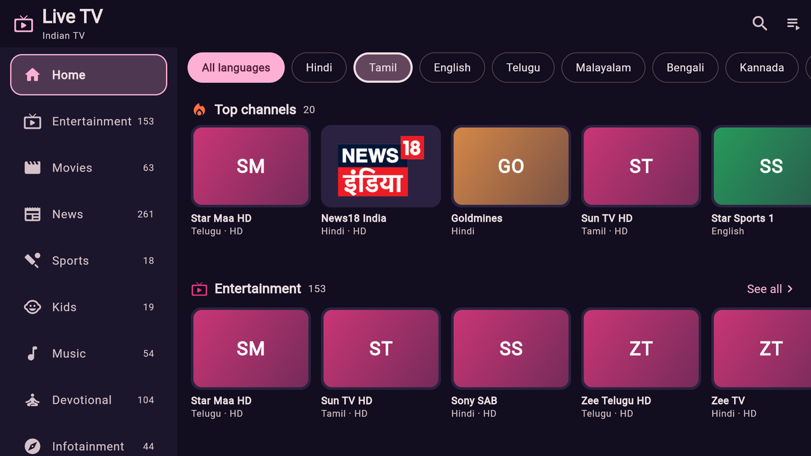
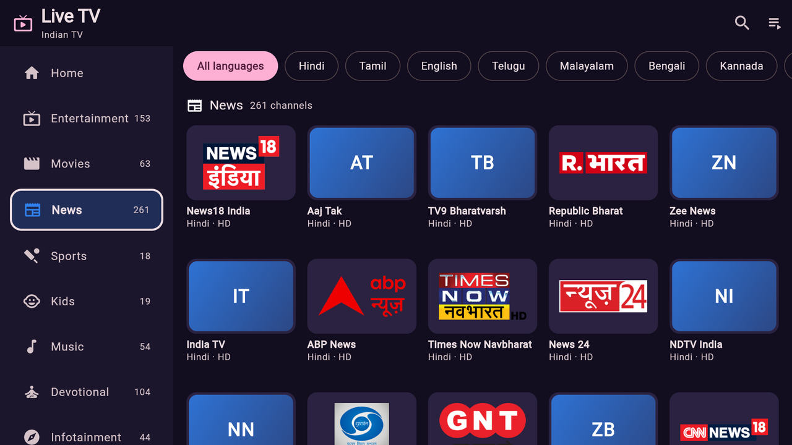
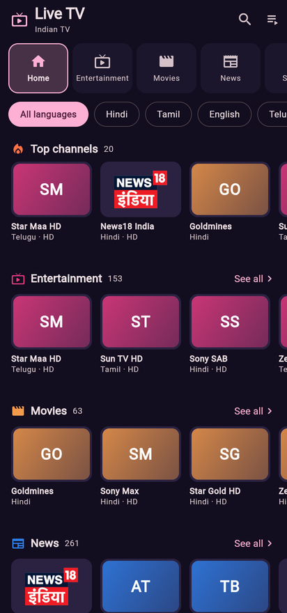
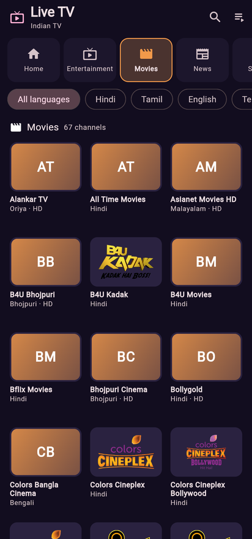
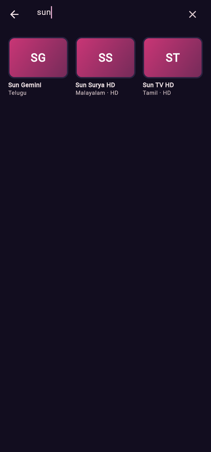

# Live TV: Indian IPTV for Android TV and phones

A redesign of [kananinirav/Indian-IPTV-App](https://github.com/kananinirav/Indian-IPTV-App)
with a channel browser modelled on the Tata Play TV app. The original shows
hundreds of channels as one long unsorted list. This version groups them by
genre and language and puts the most-watched channels first. It is built for
Android TV / Google TV remotes and also works on phones.

## Disclaimer

> [!IMPORTANT]
> - This app is a simple M3U streaming player.
> - It does not host or provide any media content.
> - All streams come from third-party sources ([iptv-org](https://github.com/iptv-org/iptv)).
> - The developer is not responsible for the legality or availability of external content.

## What changed

**Channel browser**
- **Genres** like Tata Play: Entertainment, Movies, News, Sports, Kids, Music,
  Devotional, Infotainment, Others. Genres come from the
  [iptv-org channel database](https://github.com/iptv-org/database), with
  name-based guesses for channels it doesn't know.
- **Languages**: filter everything by Hindi, Tamil, Telugu, English, Bengali, etc.
- **HD & Full HD** switch: show only channels with a 720p or better stream.
- **Most popular first**: each genre starts with its most-watched channels
  (based on BARC India ratings), then the rest A to Z. Home opens with a
  **Top channels** row that mixes the leaders of each genre.
- **Home** has a row per genre with "See all", plus **Continue watching**
  and **Favourites**.
- **Search** by channel name, language or genre.
- **Logos** for ~99% of channels, and initials on a genre colour when a logo is missing.
- **No duplicates**: "Zee TV", "Zee TV HD" and the 576p/1080p copies of a
  channel become one tile. The player tries the best working stream and
  falls back to the next one if a stream is down. You can also pick a
  quality yourself.

**Android TV / Google TV**
- Shows up on the TV home screen (leanback launcher + banner). No touchscreen is needed.
- Genre menu on the left, channel rows on the right (on phones the genres are tabs across the top).
- Full D-pad support: every tile, tab and filter has a clear focus outline.
  **OK** opens a channel, **hold OK** adds it to Favourites, **Back** returns.
- Full-screen player on TV.

**Player**
- One row of buttons, easy with a TV remote: **Play/Pause**, **Source**
  (next stream of the channel), **Size** (Full / Large / Medium / Small,
  remembered; smaller looks sharper for low-resolution channels on a big
  TV), **Open in VLC** and **Favourite**. No pop-up menus.
- Remote: any button shows the controls, **OK** presses, **⏯** pauses,
  **Back** hides the controls and then leaves. Controls fade after 5 seconds.
- If the picture freezes for 10 seconds, the player reconnects by itself
  (twice), then moves on to the channel's next source.
- Streams that need a referrer or user agent (from the playlist's
  `#EXTVLCOPT` lines) now get them.
- **Open in VLC** opens VLC directly when installed, otherwise Android's
  "Open with" list. **Full screen** button on phones.

## Screenshots

Android TV (1920×1080):

<p float="left">
  
  
</p>

Phone:

<p float="left">
  
  
  
</p>

(Some tiles show initials because the logo host was blocked where the
screenshots were taken. On a device the logos load normally.)

## Install

Every push to `main` builds an APK with GitHub Actions: open the
**Actions** tab, pick the latest **Build APK** run and download
`live-tv-apk`. One APK works on phones and on Android TV / Google TV.

To sideload on Google TV: enable *Developer options* (Settings → System →
About → click *Android TV OS build* 7 times) and allow *Install unknown apps*
for a file manager or the "Send files to TV" / "Downloader" app. Then open
the APK.

Or build it yourself (Flutter 3.47):

```sh
flutter pub get
flutter build apk --release
# build/app/outputs/flutter-apk/app-release.apk
```

## Channel data

| File | What it is | How to update |
|---|---|---|
| `data/streams.csv` | Playlists to choose from (fetched from the original repo, bundled copy as fallback). | Edit the CSV. |
| `assets/data/channel_meta.json` | Genre, languages and logo per iptv-org channel id. | `python3 tool/build_channel_meta.py`. A weekly workflow does this automatically. |
| `assets/data/popular_channels.txt` | Most-watched channels per genre, in order. | Edit the text file; names are matched ignoring case, spaces and HD/SD. |

## Credits

- Original app: [kananinirav/Indian-IPTV-App](https://github.com/kananinirav/Indian-IPTV-App) (MIT)
- Streams and channel data: [iptv-org/iptv](https://github.com/iptv-org/iptv), [iptv-org/database](https://github.com/iptv-org/database)
- Popularity order: BARC India weekly ratings as reported by exchange4media, medianews4u and indiantelevision.com
